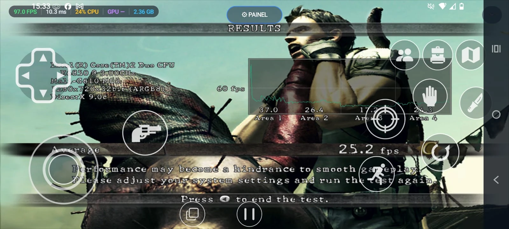

# Resident Evil 5: Gold Edition — Static Recompilation (`re5-recompiled`)

[](#how-to-install)
[-orange.svg)](#graphics)
[](#status)
[-lightgrey.svg)](#legal)

A **static recompilation** of *Resident Evil 5: Gold Edition* (Steam, `re5dx9.exe`, x86 PE32) into portable C,
running natively on **Windows x64** and **Android ARM64** with Vulkan — no Wine, no Box64, no dynamic emulation.

Based on the [pcrecomp](https://github.com/sp00nznet/pcrecomp) tooling and the
[nfsu2-recompiled](https://github.com/codepdbh/nfsu2-recompiled) reference architecture.

## It runs on a phone



▶️ **Video:** [docs/media/android_dimensity7030_benchmark.mp4](docs/media/android_dimensity7030_benchmark.mp4)

Tested on a **MediaTek Dimensity 7030 (Mali-G610 MC3) phone with 8 GB of RAM**: the game's own variable benchmark
at **1280x720, "High" settings, averages 25.2 fps** (37.0 / 26.4 / 17.2 / 24.3 fps across the four areas),
with the DXVK renderer, the on-screen touch controls and the performance HUD shown in the picture.

## Status

**0.1 alpha.** Playable from the title screen through gameplay on PC and on Android, with real limitations:

| Area | State |
|---|---|
| Single player (PC) | ✅ Playable; the benchmark runs above 80 fps on a Ryzen 7 5700U laptop. |
| Single player (Android) | ✅ Playable with touch controls or a gamepad; ~20–30 fps on mid-range phones. |
| Renderer: DXVK | ✅ Default and most compatible (PC and Android). |
| Renderer: re5vk (own Vulkan backend) | ⚠️ Faster on PC; on Android it starts on Mali and Adreno, but still shows **graphical glitches**. |
| Multiplayer (LAN / Steam emulation) | ⚠️ **Not 100%**: joining can fail, and leaving a session may crash the game. |
| Going to background on Android | ⚠️ Switching apps while in game may crash (the Vulkan surface is lost). |
| Snapdragon + DXVK | ⚠️ Characters can appear in T-pose on the stock Adreno driver. |

### Optimization (work in progress)

Mobile performance is the current focus. Done so far: the game threads run in parallel (`hle` lock mode),
big-core pinning and an ADPF performance session, Android Game Mode "performance" support, CPU tuning for
Cortex-A78/A55, and a persistent Vulkan pipeline cache for re5vk.

Known bottlenecks still being worked on:

- **GPU clock on Samsung phones:** on an Exynos 1380 (Galaxy A54) the Mali GPU stays at its minimum clock because
  Samsung's game service does not recognize a sideloaded APK as a game. Adding the app to *Game Launcher*
  is the current workaround being tested.
- **Shader compilation stutter** the first time an effect appears (cached after that).
- **Memory:** Mali GPUs have no DXT/BC texture support, so textures are decoded on the CPU and kept twice;
  transcoding to ETC2/ASTC is planned.

Details, numbers and evidence: [docs/STATUS.md](docs/STATUS.md) (in Portuguese).

## How to install

You need **your own legally purchased copy** of *Resident Evil 5: Gold Edition* (Steam). This project ships
no game files.

1. **Pack your game folder.** Make a `.zip` or `.rar` of your installed game folder (the one that contains
   `nativePC_MT`) — or, on PC, just use the folder as it is.
2. **Get the port binary for your platform** (`re5.exe` for Windows, the `.apk` for Android). Binaries are built
   from this repository; see [Building](#building). Prebuilt releases are not published, because they would
   contain recompiled game code (see [Legal](#legal)).
3. **Windows:** put `re5.exe` (and the DLLs next to it) **inside the game folder**, next to `nativePC_MT`, and run it.
   The game folder is detected from where `re5.exe` is; no command line is needed.
4. **Android:** install the APK, open it, and pick your `.zip`/`.rar` in the launcher. It extracts the game into
   the app's folder and you can start playing. Settings (renderer, resolution, FPS limit, controls layout,
   language) are in the launcher.

Tip for Samsung phones: add the app to **Game Launcher** and set Game Booster to *Performance*.

## Building

Requirements: CMake 3.22+, Ninja, Python 3.10+, MinGW-w64/Clang (Windows) or the Android NDK (r25+) and
Android Studio/Gradle (Android). The input executable `re5dx9.clean.exe` (an unprotected x86 build of the game)
must be provided by whoever owns the game, in `bin_input/`; this repository does not include it nor explain
how to remove copy protection.

```bash
pip install -r scripts/requirements.txt
python scripts/doctor.py                       # is the environment ready?
python scripts/recon.py --all                  # gate: is the input liftable?
python scripts/run_lift.py catalog && python scripts/run_lift.py lift
cmake --preset windows-x64 && cmake --build build/windows-x64
cmake --preset android-arm64 && cmake --build build/android-arm64   # then ./gradlew assembleDebug in android/
```

## Graphics

- **DXVK** (default): Direct3D 9 → Vulkan (2.6.2 on PC, a native 1.9.2b port on Android).
- **re5vk**: this project's own Direct3D 9 → Vulkan backend (`RE5_GFX=re5vk`), with its own DXSO → SPIR-V
  shader translator.

## Repository layout

```text
scripts/      pipeline: recon, lift, header generation, benchmarks, Android profiling
config/       build config, known builds, overrides/hooks, import policy
runtime/      guest memory, dispatch, thunks, PE loader, threads, VFS, Win32 HLE, D3D9 bridge, re5vk
generated/    C code produced by the lifter (generated/src is never committed)
android/      Android app: launcher, touch controls, HUD, settings (6 languages)
tests/        C unit tests, end-to-end synthetic PE32, Python tests
tools/        pcrecomp (vendored lifter)
docs/         plan, status, architecture (Portuguese)
```

## Legal

This project **does not distribute** binaries, code, assets, textures, models, audio or trademarks owned by
**Capcom Co., Ltd.** All original game files must come from a legally purchased copy of *Resident Evil 5*.
The code in this repository is open-source tooling and a clean-room compatibility runtime under the MIT license.
*Resident Evil* is a trademark of Capcom. This project is not affiliated with or endorsed by Capcom.
